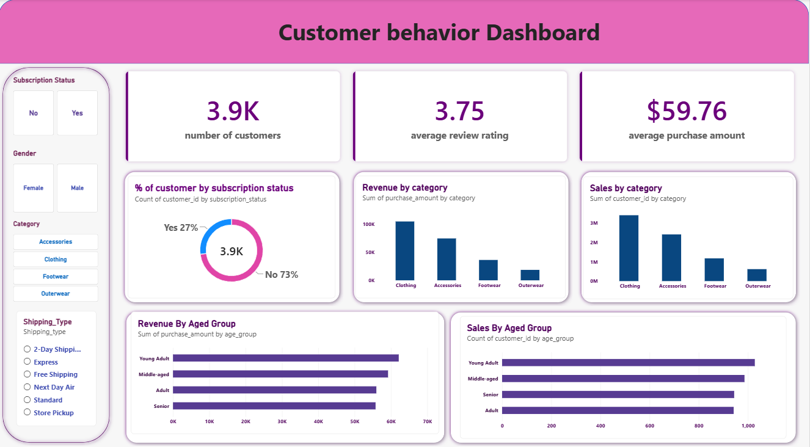

# Customer Shopping Behavior Analysis (Python | PostgreSQL | Power BI)

## Project Overview
An end-to-end data analytics project analyzing customer demographics, purchase frequency, discount impact, and category-wise revenue across 3,900 customer transactions to uncover actionable retail insights.

## Tech Stack & Workflow
- **Python (Pandas, SQLAlchemy):** Data cleaning, standardizing column names, handling missing values, feature engineering (`age_group`, `purchase_frequency_days`), and building an automated ETL pipeline into PostgreSQL.
- **PostgreSQL (pgAdmin):** Storing structured customer data and executing analytical SQL queries using aggregations, subqueries, CTEs, and window functions.
- **Power BI:** Designing an interactive executive dashboard with KPI cards, category breakdowns, and demographic comparisons.

## Dashboard Preview

## Key Business Insights
- **Overall Performance:** 3.9K total customers with an average purchase value of **$59.76** and an average review rating of **3.75**.
- **Top Revenue Category:** **Clothing** leads both total revenue and order volume, followed by **Accessories**.
- **Subscription Opportunity:** **27%** of customers are subscribed while **73%** are non-subscribers, highlighting strong potential for targeted loyalty campaigns.
- **Demographic Drivers:** **Young Adults** and **Middle-aged** segments contribute the highest overall spending.

## Repository Structure
- `customer_py.ipynb` – Python notebook for data preprocessing, feature engineering, and PostgreSQL loading.
- `customer_queries.sql` – SQL queries answering key business questions.
- `customer_behavior_dashboard.pbix` – Interactive Power BI dashboard source file.
- `customer_behavior_dashboard.pdf` – Static PDF export of the dashboard.
- `customer_data.csv` – Dataset used for the analysis..
